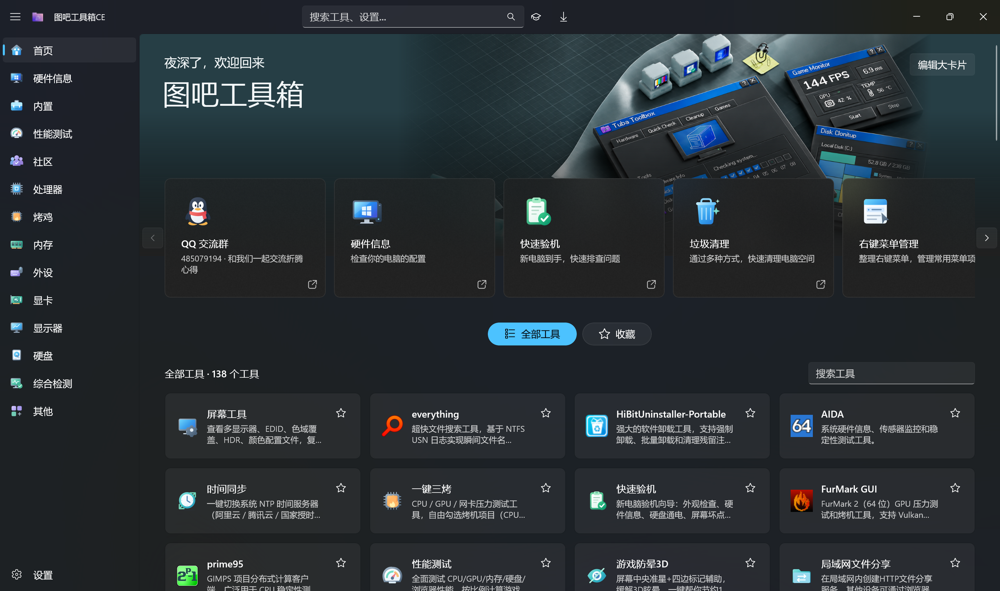
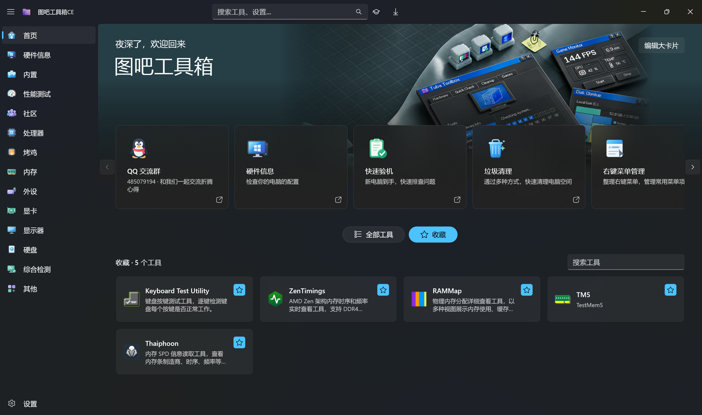
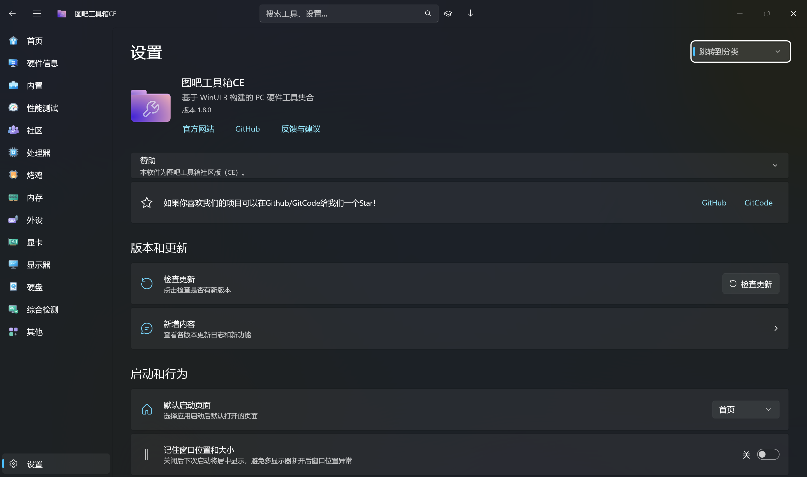

  <a href="README_EN.md">English</a> · 中文

  <picture>
    <source media="(prefers-reduced-motion: reduce)" srcset="images/readme/hero-cn.svg#still">
    
  </picture>

  
  
  
  

     

一台新电脑，从验机、跑分、装驱动到日常清理维护，都能在这里找到工具。

[官网与文档](https://tubawinui3.cn) · [国内下载镜像](https://gitcode.com/luolangaga/tubatool)

> [!WARNING]
> 请通过[官方安装指南](guide/getting-started.md#安装)列出的渠道下载，留意非官方下载站点。

## 项目介绍

  

**89 款经典工具与 47 款原生工具**，共用卡片、收藏、排序和桌面快捷方式。按分类浏览，搜索直达，常用的工具点一下星标就能收好。

  <picture>
    <source media="(max-width: 650px)" srcset="images/readme/features-cn-mobile.svg">
    
  </picture>

展开完整功能清单

* **本地 AI 试炼场** — 本地模型管理、LLM 对话、图像分类、目标检测与图像特征对比，支持 NPU / GPU / CPU 加速
* **硬件检测与性能** —— 温度 / 频率 / 功耗实时曲线、一键三烤、毒蘑菇测试、跑分排行、快速验机、磁盘健康
* **格式转换** —— 图片 / 音视频 / Word / Excel / PPT / PDF 互转，OCR 识别、PDF 合并拆分、批量队列
* **游戏工具箱** —— 可自定义布局的 FPS / 温度 / 负载悬浮层，虚拟局域网一键联机，运行库一键修复
* **系统优化与安全** —— 垃圾清理 / 启动项管理 / 右键菜单管理 / 恶意软件拦截 / 沙盒分析 / 时间同步
* **网络工具** —— 网速测试 / 流量监控 / 端口占用 / Hosts 编辑 / 局域网文件分享
* **原生 Fluent 体验** —— Mica 材质、亮暗主题、中英双语、全局搜索、收藏拖拽排序

再看看常用页和设置中心

  
  

[查看当前版本的全部功能截图](https://tubawinui3.cn/features)

### 文档导航

| 文档 | 内容 |
|:-----|:-----|
| [功能详解](guide/features.md) | AI 助手、硬件检测与性能、游戏、系统优化、网络、格式转换、实用工具 |
| [内置工具（47 款）](guide/builtin-tools.md) | 原生 Fluent 工具完整清单 |
| [收录工具（89 款）](guide/bundled-tools.md) | 随包第三方工具分类清单 |
| [快速开始](guide/getting-started.md) | 系统要求、安装方式（Releases / Winget / Scoop / Store）、从源码构建 |
| [架构](guide/architecture.md) | 目录结构、模块说明与实现细节 |
| [常见问题](guide/faq.md) | UAC、杀毒误报、便携使用、日志位置等 |
| [交流与链接](guide/community.md) | QQ 群、贡献者、相关链接、项目数据 |

---

## 荣誉与认可

查看项目收录与榜单

* **AtomGit G-Star 毕业项目** —— 通过 [AtomGit](https://atomgit.com) 官方评审取得毕业认证（编号 No.0614，2026.07.24），欢迎关注 [atomgit.com/luolangaga/tubatool](https://atomgit.com/luolangaga/tubatool)
* **HelloGitHub 收录推荐** —— 在 [HelloGitHub](https://hellogithub.com/repository/luolangaga/tubatools) 项目库中获得推荐
* **Trendshift 收录** —— 在 [Trendshift](https://trendshift.io/repositories/51042) 上登过 C# 分类日榜与月榜

---

## Code signing policy

> Free code signing provided by [SignPath.io](https://about.signpath.io), certificate by [SignPath Foundation](https://signpath.org).

由 [SignPath.io](https://about.signpath.io) 提供免费代码签名，证书由 [SignPath Foundation](https://signpath.org) 颁发。签名在自动化构建流程中完成，因此签名代表该二进制是由本仓库源码自动构建产生的 —— 构建须通过可信构建系统（GitHub Actions）校验来源，并经 Approver 人工批准后才会签名。

- **Committers / Reviewers**: [@luolangaga](https://github.com/luolangaga)
- **Approvers**: [@luolangaga](https://github.com/luolangaga)
- **隐私政策 / Privacy policy**: [PrivacyPolicy.txt](PrivacyPolicy.txt)

---

## 捐赠支持

如果这个工具箱对你有帮助，欢迎请我喝杯奶茶 ☕ 感谢每一位支持者！

---

<a href="https://star-history.com/#luolangaga/tubatools&type=date&legend=bottom-right">
  <picture>
    <source media="(prefers-color-scheme: dark)" srcset="https://api.star-history.com/svg?repos=luolangaga/tubatools&type=date&theme=dark&legend=bottom-right" />
    <source media="(prefers-color-scheme: light)" srcset="https://api.star-history.com/svg?repos=luolangaga/tubatools&type=date&legend=bottom-right" />
    
  </picture>
</a>

**如果觉得有用，给个 Star 吧！**

WinUI 3 · .NET 10 · Windows App SDK · GPL-3.0 · [许可证](LICENSE)

