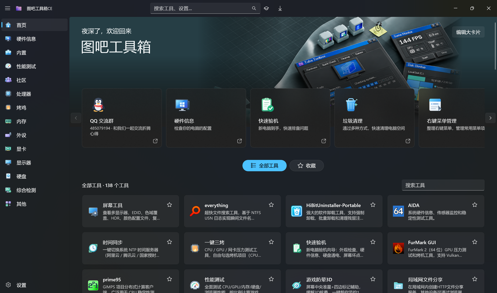
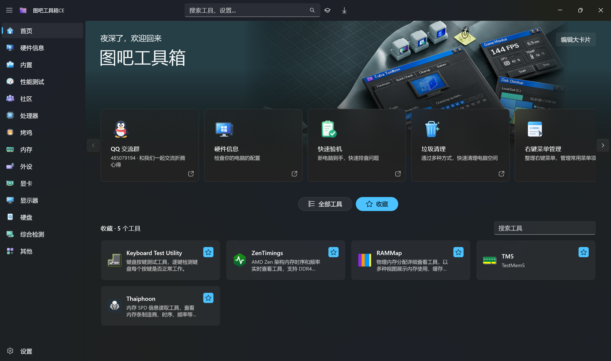
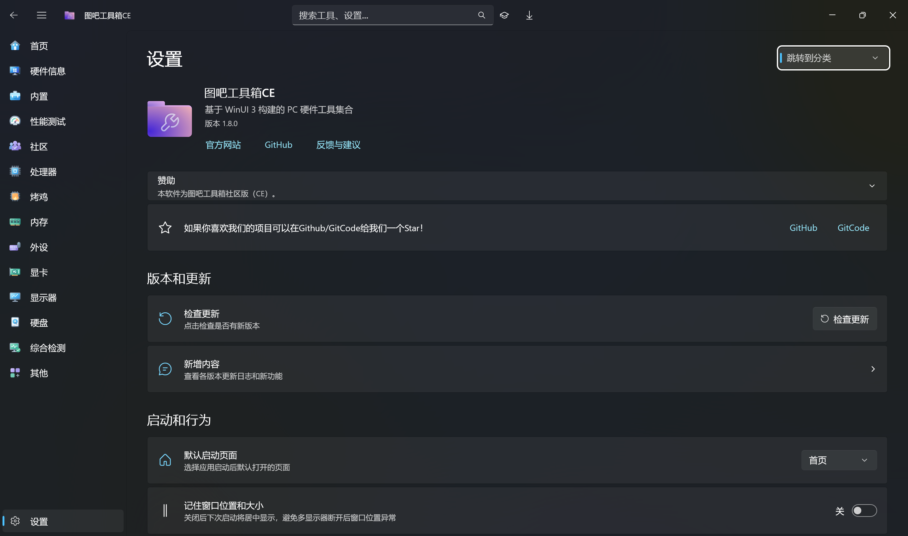

  English · <a href="README.md">中文</a>

  <picture>
    <source media="(prefers-reduced-motion: reduce)" srcset="images/readme/hero-en.svg#still">
    
  </picture>

  
  
  
  

     

Tools for a new PC, from first-boot checks and benchmarks to drivers, cleanup and everyday maintenance.

[Official website and docs](https://tubawinui3.cn) · [Download mirror](https://gitcode.com/luolangaga/tubatool)

This English README is translated by AI and may contain inaccuracies.

> [!WARNING]
> Download through the official channels listed in the [installation guide](guide/en/getting-started.md#installation).

## About

  

**89 classic tools and 47 native utilities** share cards, favorites, sorting and desktop shortcuts. Browse a category, search for a tool, and star the ones you use most.

  <picture>
    <source media="(max-width: 650px)" srcset="images/readme/features-en-mobile.svg">
    
  </picture>

Explore the full feature list

* **Local AI Playground** — local model management, LLM chat, image classification, object detection and image comparison, with NPU / GPU / CPU acceleration
* **Hardware Detection & Performance** — live temperature / frequency / power curves, stress tests, fractal GPU test, benchmark leaderboards, new-PC check and disk health
* **Format Converter** — images / audio & video / Word / Excel / PPT / PDF conversion, OCR, PDF merge & split and batch queues
* **Gaming Toolbox** — a customizable FPS / temperature / load overlay, one-click virtual LAN co-op, and runtime repair
* **System Optimization & Security** — junk cleaner / startup manager / context menu manager / malware blocker / sandbox analysis / time sync
* **Network Tools** — speed test / traffic monitor / port viewer / hosts editor / LAN file sharing
* **Native Fluent Experience** — Mica material, light & dark themes, English and Chinese UI, global search, drag-to-reorder favorites

More screenshots of favorites and settings

  
  

[View all current feature screenshots](https://tubawinui3.cn/features)

## Documentation

| Document | Contents |
|:---------|:---------|
| [Features](guide/en/features.md) | AI Assistant, hardware detection & performance, gaming, system optimization, network, format conversion, utilities |
| [Built-in Tools (47)](guide/en/builtin-tools.md) | The complete native Fluent tool list |
| [Bundled Tools (89)](guide/en/bundled-tools.md) | Third-party tools that ship with the app, by category |
| [Getting Started](guide/en/getting-started.md) | System requirements, installation (Releases / Winget / Scoop / Store), building from source |
| [Architecture](guide/en/architecture.md) | Directory layout, module notes and implementation details |
| [FAQ](guide/en/faq.md) | UAC, antivirus flags, portable use, log locations and more |
| [Plugin Development](插件开发文档.md) | Add tools through plugins (API v2); the SDK ships as a NuGet package ([online](https://tubawinui3.cn/dev/plugin)) |
| [Community & Links](guide/en/community.md) | QQ group, contributors, links and project analytics |

---

## Contributors

Thanks to everyone who has contributed code, filed issues or improved the docs — this toolbox is better because of you. Want to join them? Start with the [contributing guide](CONTRIBUTING.md).

---

## Recognition

Project listings and rankings

* **AtomGit G-Star graduated project** — passed the official [AtomGit](https://atomgit.com) review and earned the G-Star Graduation Certification (No.0614, 2026.07.24); follow us at [atomgit.com/luolangaga/tubatool](https://atomgit.com/luolangaga/tubatool)
* **Featured by HelloGitHub** — listed and recommended in the [HelloGitHub](https://hellogithub.com/repository/luolangaga/tubatools) repository library
* **Trendshift** — charted on the daily and monthly C# lists at [Trendshift](https://trendshift.io/repositories/51042)

---

## Code signing policy

> Free code signing provided by [SignPath.io](https://about.signpath.io), certificate by [SignPath Foundation](https://signpath.org).

Signing happens inside the automated build pipeline, so a signature means the binary is an automated build of this repository's source: the build must pass trusted build system (GitHub Actions) origin verification and be manually approved by an Approver before it is signed.

- **Committers / Reviewers**: [@luolangaga](https://github.com/luolangaga)
- **Approvers**: [@luolangaga](https://github.com/luolangaga)
- **Privacy policy**: [PrivacyPolicy.txt](PrivacyPolicy.txt)

---

## Donate

If this toolbox has been useful to you, you're welcome to buy me a milk tea ☕ — thank you to everyone who supports it!

---

<a href="https://star-history.com/#luolangaga/tubatools&type=date&legend=bottom-right">
  <picture>
    <source media="(prefers-color-scheme: dark)" srcset="https://api.star-history.com/svg?repos=luolangaga/tubatools&type=date&theme=dark&legend=bottom-right" />
    <source media="(prefers-color-scheme: light)" srcset="https://api.star-history.com/svg?repos=luolangaga/tubatools&type=date&legend=bottom-right" />
    
  </picture>
</a>

**If you find this useful, please give it a star!**

WinUI 3 · .NET 10 · Windows App SDK · GPL-3.0 · [License](LICENSE)

