[← Back to README](../../README_EN.md)

# Features

  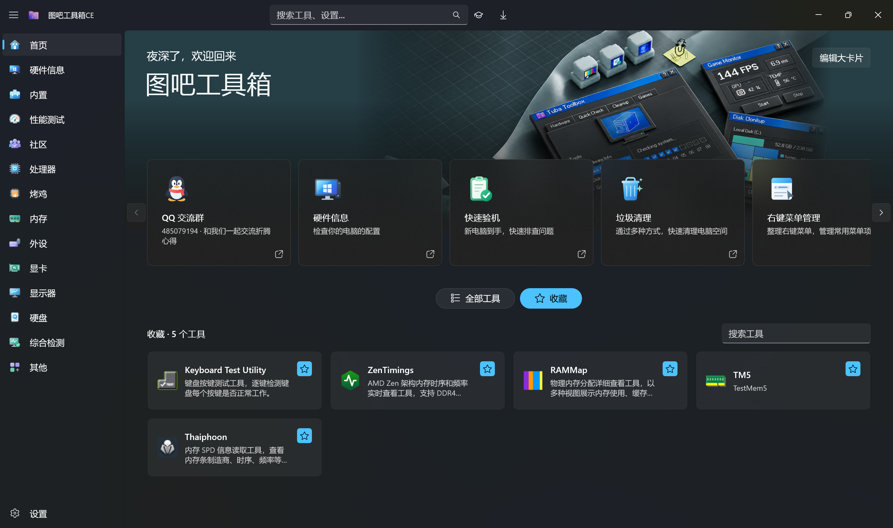
  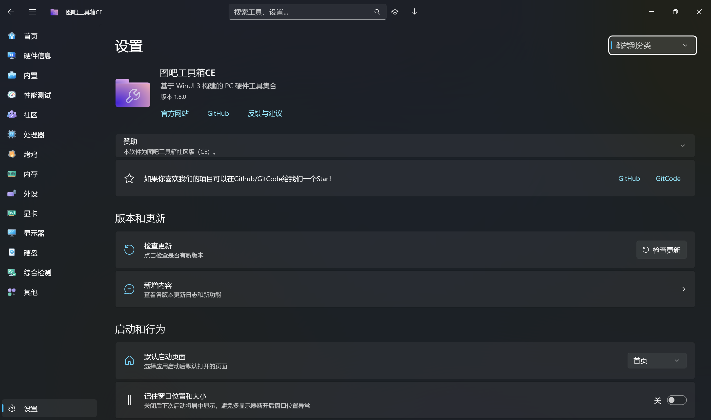

  Left: a favorites page ranked by how often you use each tool, with drag-to-reorder ｜ Right: Mica material, light/dark themes, UI language and data backup

The left navigation browses every tool by category, the search box at the top finds any of them, and a star puts the ones you like on the favorites page.
**The 89 bundled classic tools and the 47 built-in native tools share one card layout, one favorites list, one sort order and one desktop-shortcut path** — so it never feels like two separate products.

## Feature Highlights

* **AI Assistant** — a built-in system agent: reads hardware info, analyzes disk usage, cleans junk, reads/writes files, runs commands and searches the web, with 28 agent tools and confirmation for risky actions
* **Hardware Info & Live Monitoring** — live temperature, frequency and power curves for CPU / GPU / memory / disk, with CPU-Z data verification
* **Benchmarks & Leaderboards** — full CPU / GPU / memory / disk / browser tests, PDF report export and community cloud leaderboards
* **Format Converter** — images / audio & video / Word / Excel / PPT / PDF, plus OCR, PDF merge & split and batch queues
* **Gaming Toolbox** — a customizable FPS / temperature / load overlay, one-click virtual LAN co-op, and runtime repair
* **System Optimization & Security** — junk cleaner / startup manager / context menu manager / malware blocker / sandbox analysis / time sync
* **Network Tools** — speed test / traffic monitor / port viewer / hosts editor / LAN file sharing
* **Native Fluent Experience** — Mica material, rounded windows, light & dark themes, English and Chinese UI, global search, drag-to-reorder favorites
* **No Accidental Quits** — turn on "minimize to the system tray on close" in Settings (or the first-run wizard) and closing the window keeps the app resident, so the hardware data already loaded is not scanned again; double-click the tray icon to restore the window, or right-click it to really exit
* **An Extensible Tool List** — drop your own tools into the `Tools/` folder and they are picked up; metadata lives in `Metadata/tools.json`
* **Clean** — the portable build runs straight after extraction and the installer is per-user; there are no background services, and "Exit" in the tray menu really ends the process

## AI Assistant

The built-in system agent is what "let AI drive your PC" looks like inside a toolbox: it does not just answer questions, it calls system tools — reading hardware info, analyzing disk usage, cleaning junk, reading and writing files, running commands and searching the web.

  

  Streaming reasoning, inline tool calls and confirmation for risky operations; works with any OpenAI-compatible provider and model

* **System-level tool calling** — 28 built-in agent tools (hardware info, disk analysis, process management, file I/O, command execution, web search and more), with a confirmation dialog before anything risky
* **Full-access mode** — an optional "full access" switch: turn it on and expert workflows run without a prompt each time
* **Visible reasoning** — the reasoning chain streams in, and long answers collapse automatically
* **Memory & skills** — cross-session memory (`memory.md`) and per-session skills; the longer you use it, the better it knows your machine
* **Model freedom** — a built-in model works out of the box, or point it at any OpenAI-compatible endpoint (DeepSeek / OpenAI / a local model…)
* **Loop guardrails** — repeated tool calls are blocked, reasoning and tool results are length-capped, and a session that keeps making no progress is stopped on purpose

## Hardware Detection & Performance

### Benchmarks & Leaderboards

Five suites — CPU / GPU / memory / disk / browser — are scored into "gaming performance" and "office performance" ratings and exported as a professional PDF report.

  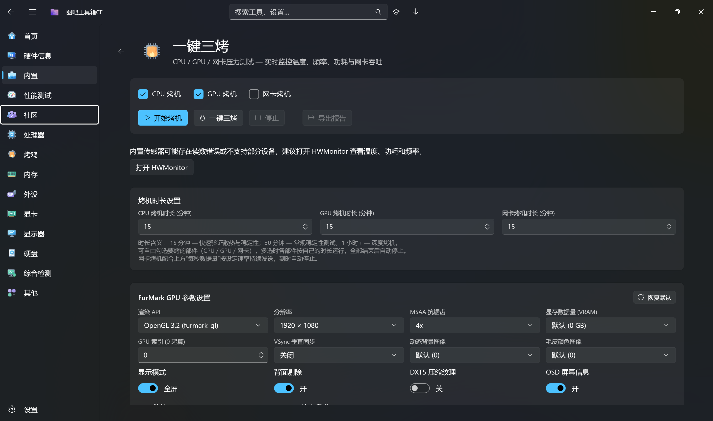
  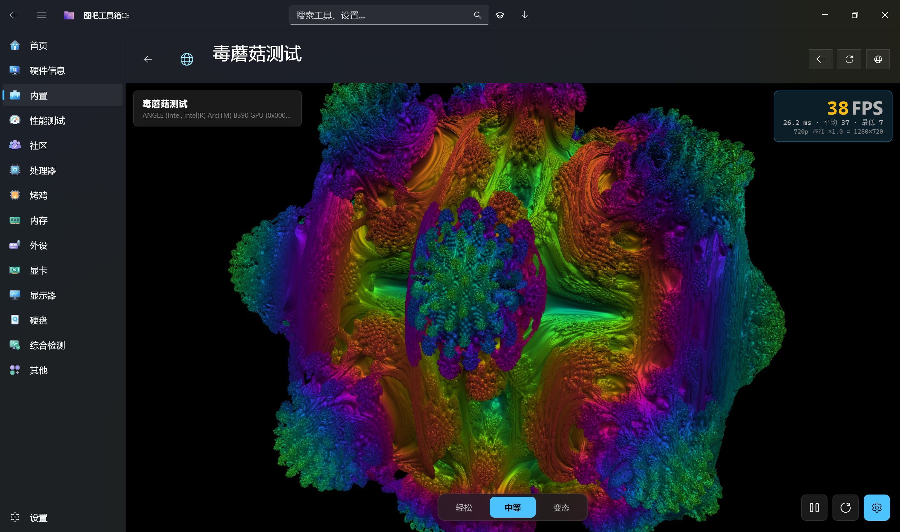

  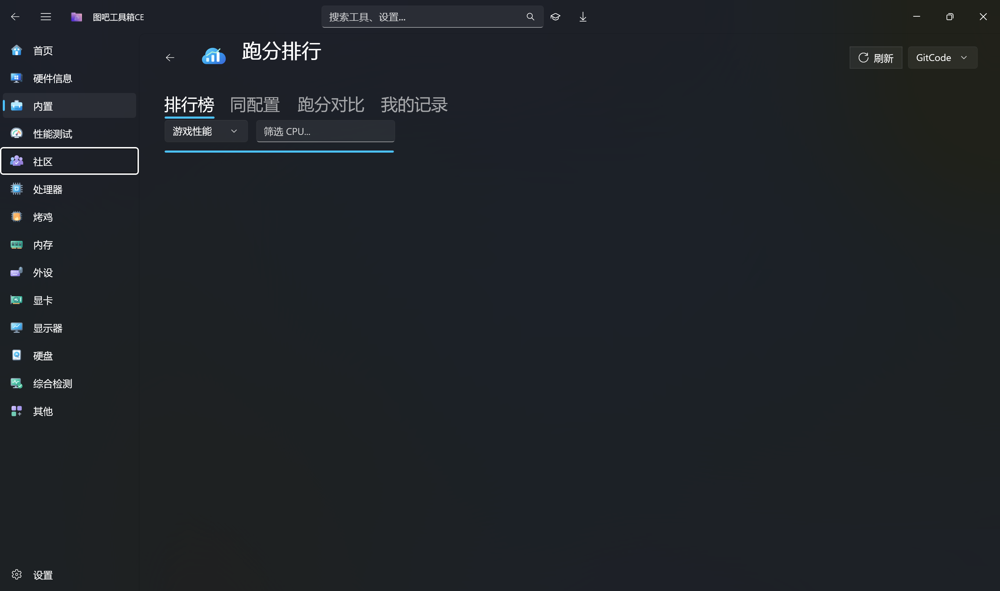
  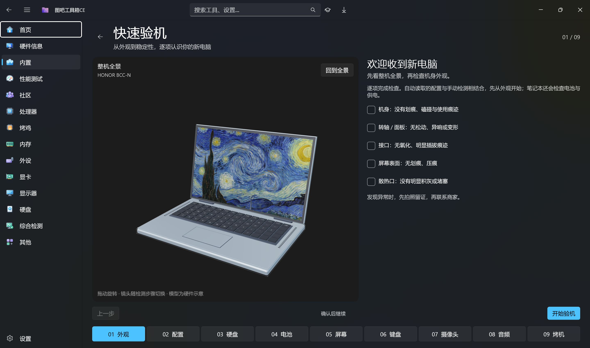

  Stress test ｜ Fractal GPU stress test ｜ Community leaderboard ｜ New-PC check wizard

* **Stress test** — run CPU and GPU stress tests separately or together while watching temperature, clock speed, and power
* **Fractal GPU test** — a GPU fractal stress test with easy / medium / extreme pressure levels, super-resolution rendering and live FPS
* **Benchmark leaderboards** — upload reports to the community, browse global rankings and compare against users with the same hardware
* **New-PC check wizard** — one pass over appearance, hardware info, disk power-on hours, dead pixels, peripherals, camera and audio

### More Hardware Tools

  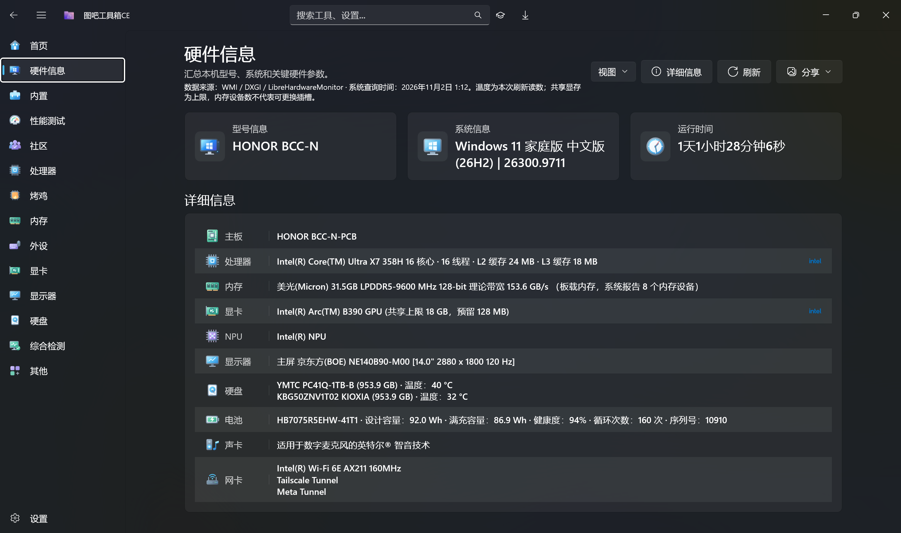
  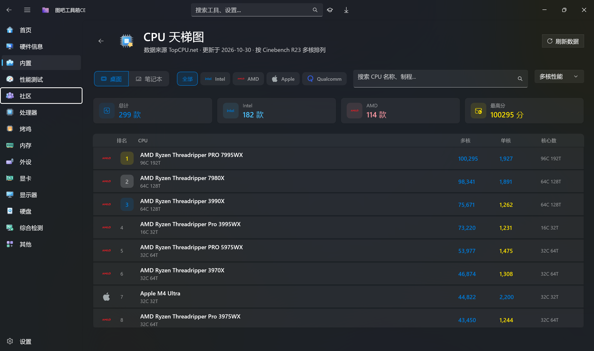

  Model / OS / CPU / memory / GPU / disk / NIC at a glance, plus desktop and laptop performance rankings (data from NanoReview)

* **Live monitoring** — temperature, frequency and power curves for CPU / GPU / memory / disk, shown in the page header or as an in-game overlay
* **Disk health** — SMART health checks (the CrystalDiskInfo approach): temperature / power-on time / lifespan / read-write totals, plus SSD TRIM and HDD defrag
* **Battery analyzer** — battery drain trends and per-app power rankings, a stronger report than what Windows Settings gives you
* **Keyboard & screen tests** — highlighted key detection (left/right Shift, Ctrl and Alt are distinguished) and full-screen solid colors / patterns to spot dead pixels and backlight bleed
* **Core-to-core latency** — browse community-uploaded latency heatmaps and compare core-to-core communication across CPUs

## Gaming Toolbox

### Game Monitor (overlay designer)

Design your monitoring overlay by dragging components: several layout presets ship in the box, and you can add FPS, CPU / GPU temperature and load, memory usage and more. It shows live in-game, and selected metrics can be recorded (up to 2 hours) and exported afterwards as a JSON / Markdown / CSV report.

  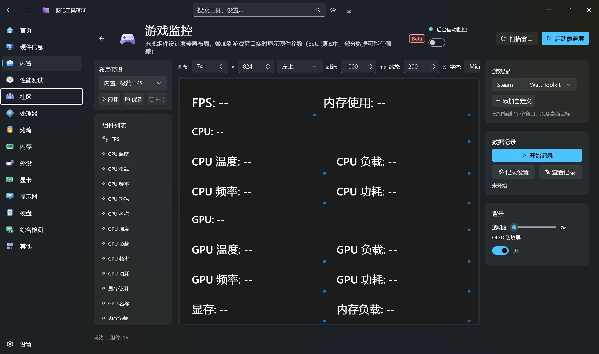
  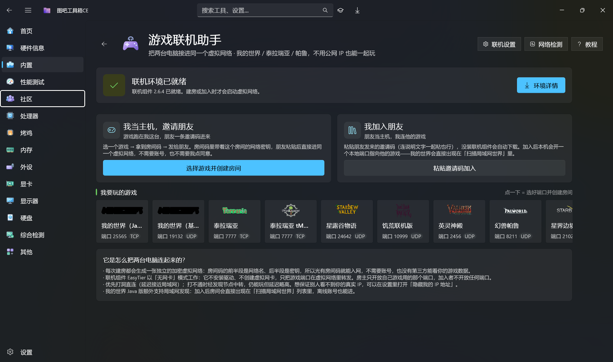

  Drag-and-drop overlay layout, with automatic game-window detection ｜ Join by invite code — no public IP, no router changes

* **LAN co-op helper** — an account-free virtual network built on EasyTier (no driver, no virtual adapter), so TCP / UDP games like Minecraft, Terraria and Palworld connect directly; the room code carries the network key, so a friend just pastes it to join, and Minecraft worlds show up straight in the LAN list
* **Recording viewer** — replays exported logs as charts: one chart per metric with its own Y axis, plus group switching, range trimming and P1 / P99 statistics
* **Runtime repair** — one-click install of missing Visual C++ 2008-2026, .NET Framework and legacy DirectX game components (official Microsoft sources with signature checks)
* **3D anti-motion-sickness** — a center crosshair plus edge markers to ease 3D motion sickness

## System Optimization & Security

  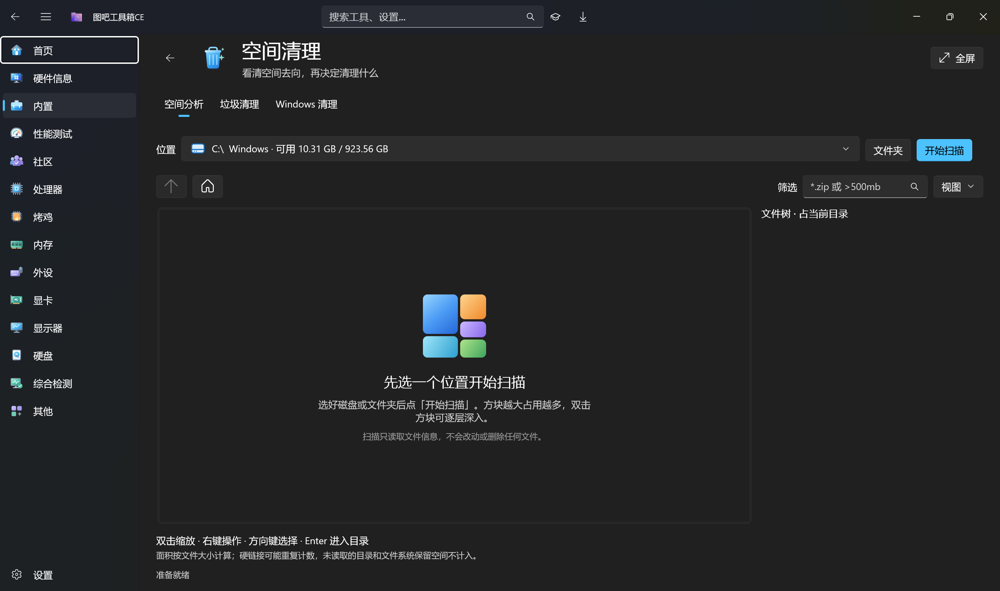
  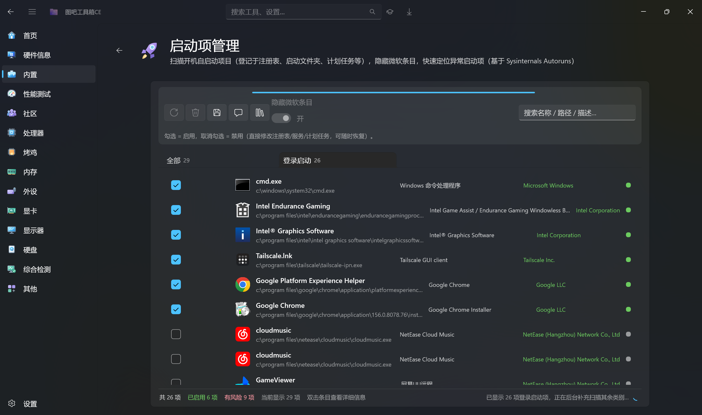
  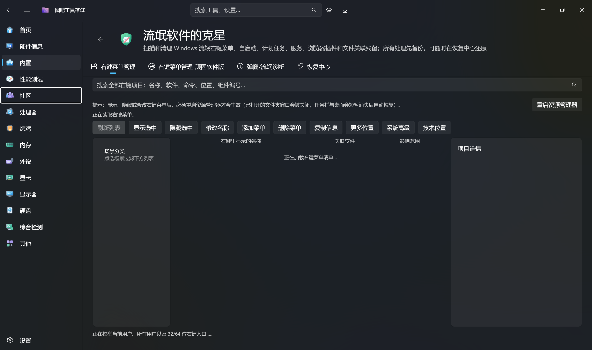

  Junk cleaner (4000+ Winapp2 rules) ｜ Startup manager ｜ Rogue software cleaner, with a restore center

* **Malware blocker** — adds software vendor certificates to the system's untrusted list, stopping rogue software from installing or running in the first place
* **Malware sandbox** — a Sandboxie-Plus environment to run and analyze suspicious programs safely; delete the sandbox and the system is back as it was
* **Context menu manager** — enable / disable / edit / add / delete context menu entries, covering New, Send to, Open with and the WinX menus
* **Time sync** — switch the system NTP server in one click (Aliyun / Tencent Cloud / NICT…), with server speed tests, offset detection, instant resync and one-click repair
* **And more** — hardware spoofer / Windows hidden features / .NET environment repair / background throttle saver / OptimizerDuck / Windows image download

## Network Tools

  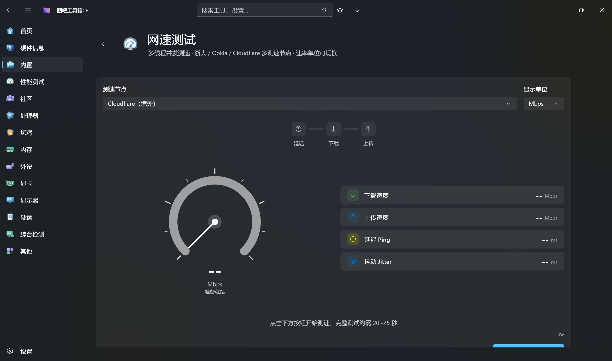
  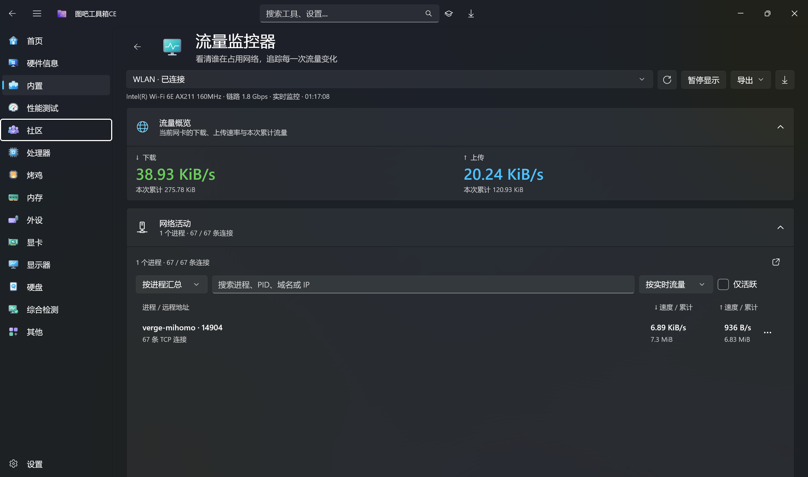
  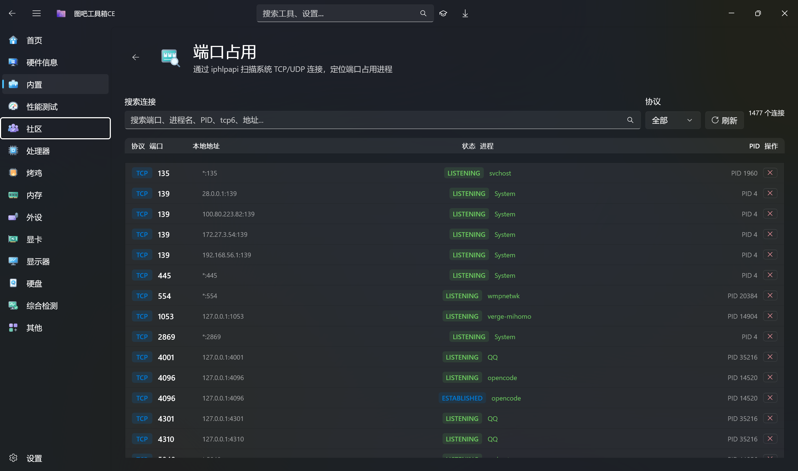

  Speed test (Zhejiang University / Ookla / Cloudflare nodes) ｜ Traffic monitor ｜ Port viewer

* **Hosts editor** — a visual editor for the system hosts file, with per-rule toggles and DNS flush
* **WiFi passwords** — view the names and passwords of the WiFi networks this machine has joined
* **Network optimizer** — TCP parameter tuning, DNS latency testing and configuration, public IP lookup, network reset and DHCP repair
* **Network scheduler** — aggregates multiple adapters, distributes traffic intelligently and accelerates automatically when Wi-Fi and Ethernet are both up
* **LAN file sharing** — an HTTP file-sharing service on your LAN that other devices open in a browser, with drag-and-drop upload

## Format Converter

Drop files in, pick a target format, and let the batch queue work through them one by one: images / audio & video / Word / Excel / PPT / PDF / text / JSON, **where one failed file never interrupts the batch**.

  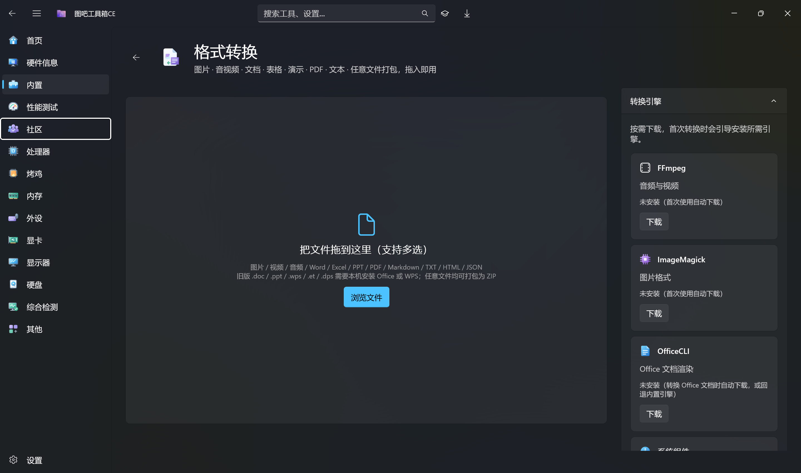

  Drag-and-drop and multi-select, batch queue processing, optional ZIP delivery; every target format carries its own tunable parameters (bitrate / bit depth / sample rate / CRF / resolution / frame rate…)

* **Document conversion** — Word / Excel / PPT / PDF / Markdown / HTML / JSON in any direction; for OOXML documents a built-in rendering engine exports PDFs and long images page by page with zero re-sampling
* **Images / audio & video** — FFmpeg and ImageMagick under the hood, with encoder, rate control, preset, resolution and audio-track options for video
* **OCR** — Windows' native OCR turns images into text in one step
* **PDF tools** — merge, split, and extract tables from the text layer into XLSX
* **Legacy formats** — old .doc / .ppt / .wps files are handed to a locally installed Office or WPS, and you get a clear message if neither is present

## Phone Link (TubaLink)

* **QR pairing** — scan the QR code shown on the PC to connect; TLS with certificate pinning, and the first connection needs approval on the PC
* **Share sheet to PC** — share text, images or files from the gallery, browser or file manager straight into the PC's Downloads folder
* **Background receive & download queue** — file pushes from the PC still arrive while the phone app is in the background, with progress, cancel and retry
* **Camera live view** — enable "Allow phone to view camera" on the PC, then watch the camera live and save snapshots from the phone
* **Second-screen mode** — build a grid dashboard on the phone with text, clock, images, metrics, charts, ring gauges, status and dividers, then show it fullscreen
* **Real-time monitoring / remote shell / winget / chat transfer** — inspect hardware and live data, run PowerShell, install software, and exchange messages/files

## Utilities

  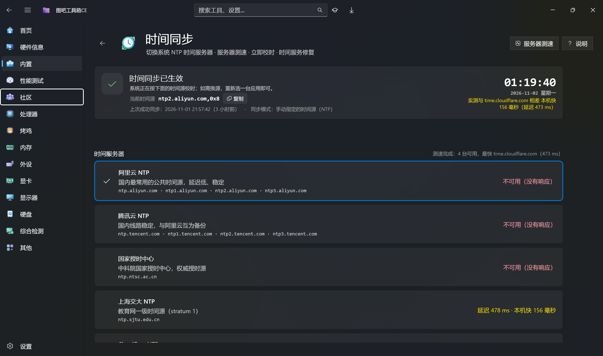
  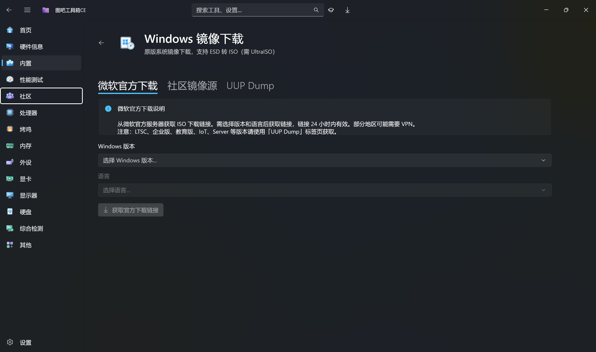
  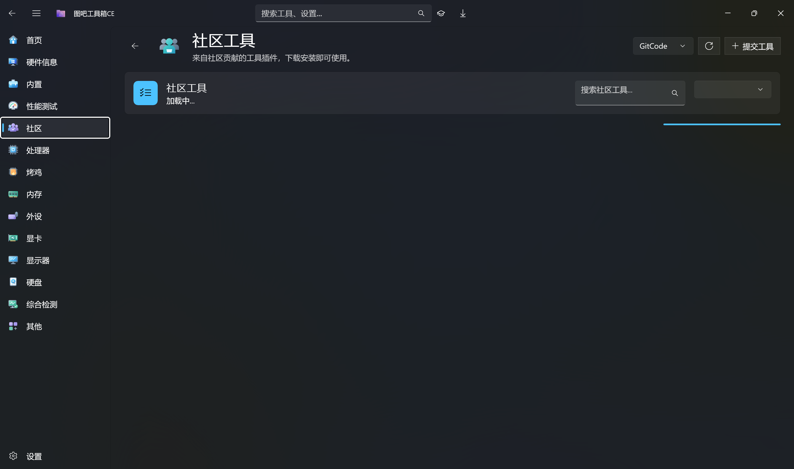

  Time sync (NTP server speed test and one-click resync) ｜ Windows image download (UUP Dump API) ｜ Community tools

* **PC tutorials** — new-PC unboxing guide, basics, burn-in checks, and common-sense myth busting
* **Official websites & service centers** — one-click access to Steam, Epic, UU Accelerator and more; plus official service-center addresses for major brands
* **Genuine software store / UniGetUI** — browse and install software through WinGet, or manage packages from winget / scoop / chocolatey / pip / npm in one GUI
* **Digital literacy test** — 25 multiple-choice questions on PC basics, to see where you stand
* **Community tools** — tool plugins contributed by the community, downloadable and ready to use (portable build only)
