[← 返回 README](../README.md)

# 功能详解

  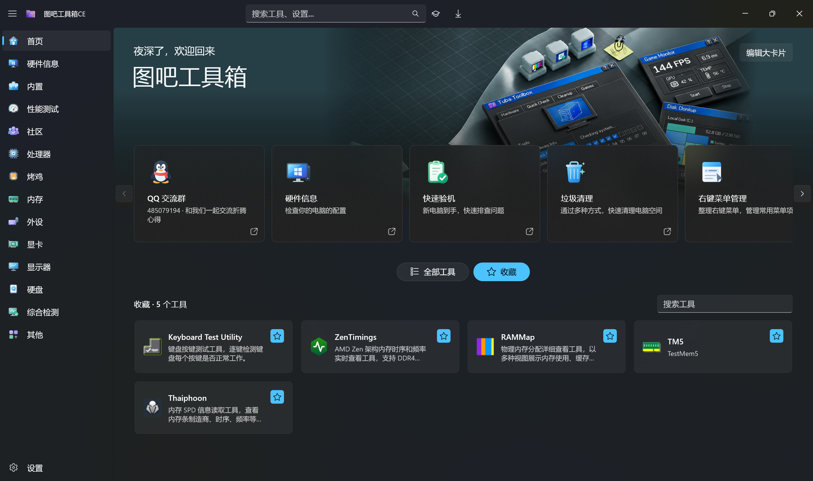
  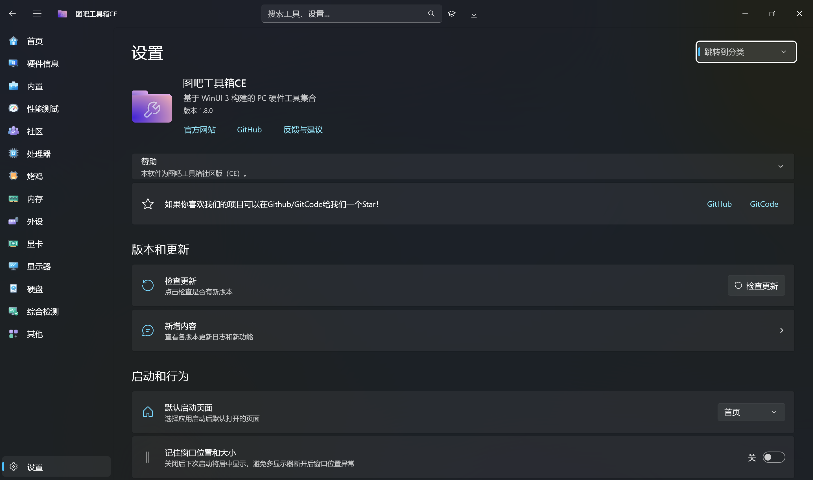

  左边：按使用频率推荐的常用页，收藏可拖拽排序 ｜ 右边：Mica 材质、亮暗主题、界面语言、数据备份都在设置里

左侧导航按分类浏览全部工具，顶部一个搜索框能搜到任何一款工具，觉得好用就点星标收进常用页。
**收录的 89 款经典工具 + 内置的 47 款原生工具，共用同一套卡片、收藏、排序与桌面快捷方式**——用起来没有「两套东西」的感觉。

## 功能亮点

* **AI 助手** —— 内置智能系统代理：读硬件、分析磁盘、清理垃圾、读写文件、执行命令、联网搜索，28 个 Agent 工具 + 危险操作确认
* **硬件信息与实时监控** —— CPU / GPU / 内存 / 硬盘的温度、频率、功耗实时曲线，支持 CPU-Z 数据覆盖校验
* **性能测试与跑分** —— CPU / GPU / 内存 / 硬盘 / 浏览器全项测试，导出 PDF 报告，社区云端排行榜对比
* **格式转换** —— 图片 / 音视频 / Word / Excel / PPT / PDF 互转，OCR 识别、PDF 合并拆分、批量队列
* **游戏工具箱** —— 可自定义布局的 FPS / 温度 / 负载悬浮层，虚拟局域网一键联机，运行库一键修复
* **系统优化与安全** —— 垃圾清理 / 启动项管理 / 右键菜单管理 / 恶意软件拦截 / 沙盒分析 / 时间同步
* **网络工具** —— 网速测试 / 流量监控 / 端口占用 / Hosts 编辑 / 局域网文件分享
* **原生 Fluent 体验** —— Mica 材质、圆角窗口、亮暗主题、中英双语界面、全局搜索、收藏拖拽排序
* **关窗不误退** —— 可在设置（或首次向导）中开启「关闭窗口时最小化到系统托盘」：点 × 不退出，留在托盘继续运行，已加载的硬件信息不用重新检测一遍；双击托盘图标恢复窗口，右键「退出」才是真退出
* **工具清单可扩展** —— 把自己的工具丢进 `Tools/` 目录就能被识别，元数据在 `Metadata/tools.json` 里改
* **干净** —— 便携版解压即用，安装版每用户安装；没有常驻后台服务，托盘右键「退出」即真正结束进程

## AI 助手

内置的智能系统代理把「让 AI 直接操作电脑」做进工具箱：它不只回答问题，还能调用系统工具——读取硬件信息、分析磁盘占用、清理垃圾、读写文件、执行命令、联网搜索。

  

  思考过程流式展示、内联工具调用与危险操作确认；可配置任意 OpenAI 兼容服务商与模型

* **系统级工具调用** —— 内置 28 个 Agent 工具（硬件信息、磁盘分析、进程管理、文件读写、命令执行、联网搜索等），危险操作先弹窗确认
* **完全访问模式** —— 可开关的「完全访问」权限，放开后无需逐条确认，专家用法一气呵成
* **思考过程可视化** —— 推理链（reasoning）流式展示，长回复自动折叠
* **记忆与技能** —— 跨会话记忆（`memory.md`）、技能按会话启用，用得越久越懂你的机器
* **模型自由** —— 内置小图吧自带模型开箱即用，也可接入任意 OpenAI 兼容端点（DeepSeek / OpenAI / 本地模型……）
* **防死循环护栏** —— 重复的工具调用会被拦截，思维链与工具结果有长度上限，连续无进展的循环会被主动终止

## 硬件检测与性能

### 性能测试与跑分排行

CPU / GPU / 内存 / 硬盘 / 浏览器五大项全测，按比例折算「游戏性能 / 办公性能」评分并导出专业 PDF 报告。

  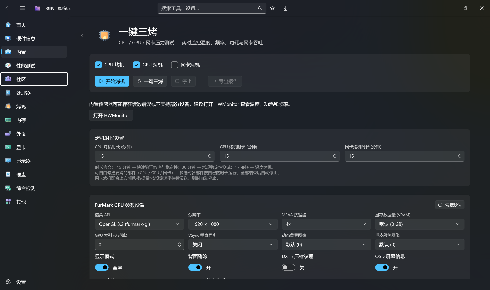
  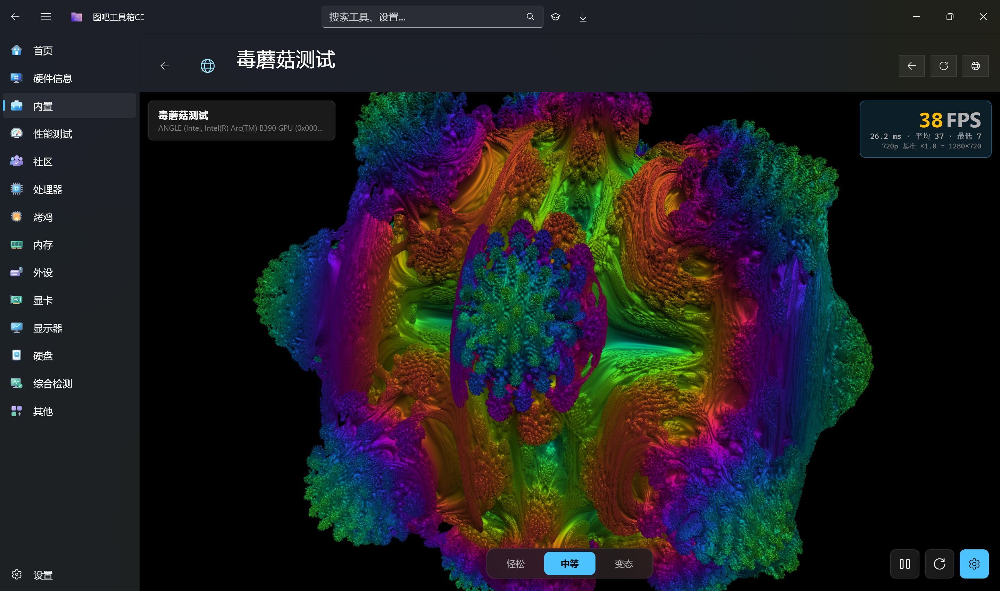

  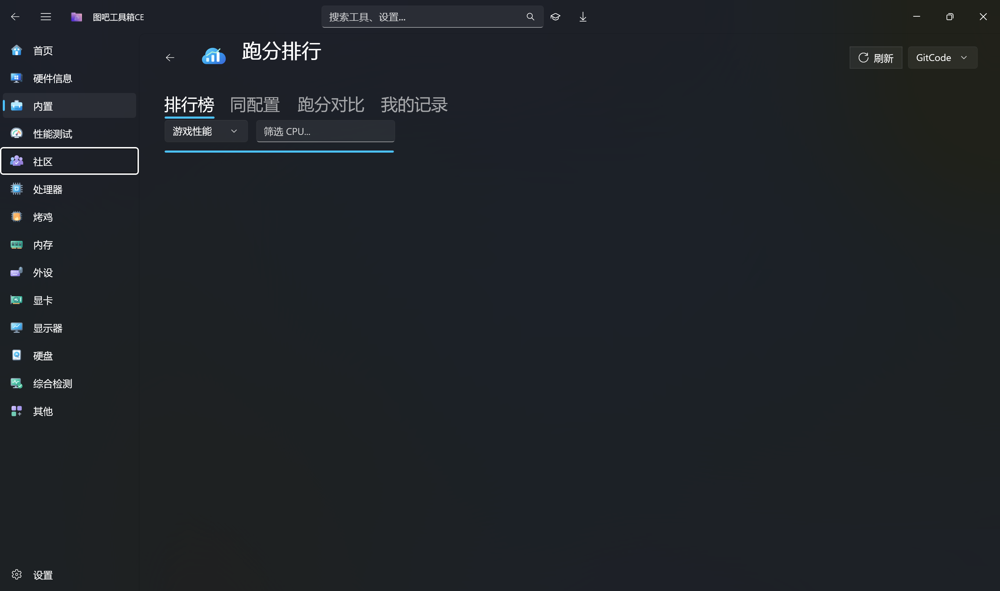
  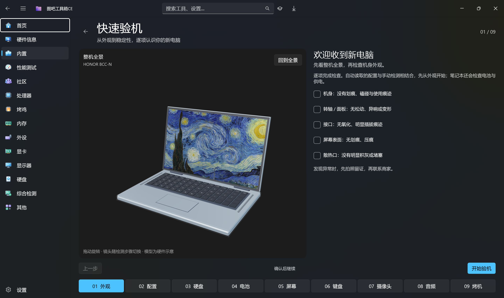

  CPU / GPU 烤机 ｜ 毒蘑菇测试 ｜ 社区跑分排行 ｜ 快速验机向导

* **CPU / GPU 烤机** —— CPU 和 GPU 可单独或同时烤机，实时监控温度、频率和功耗
* **毒蘑菇测试** —— GPU 分形压力测试：轻松 / 中等 / 变态三档压力，超分辨率渲染 + 实时帧率
* **跑分排行** —— 上传测试报告到社区，查看全球排行榜，与同硬件用户对比性能
* **快速验机** —— 新电脑验机向导：外观 / 硬件 / 硬盘通电 / 屏幕坏点 / 外设 / 摄像头 / 音频一站式

### 更多硬件工具

  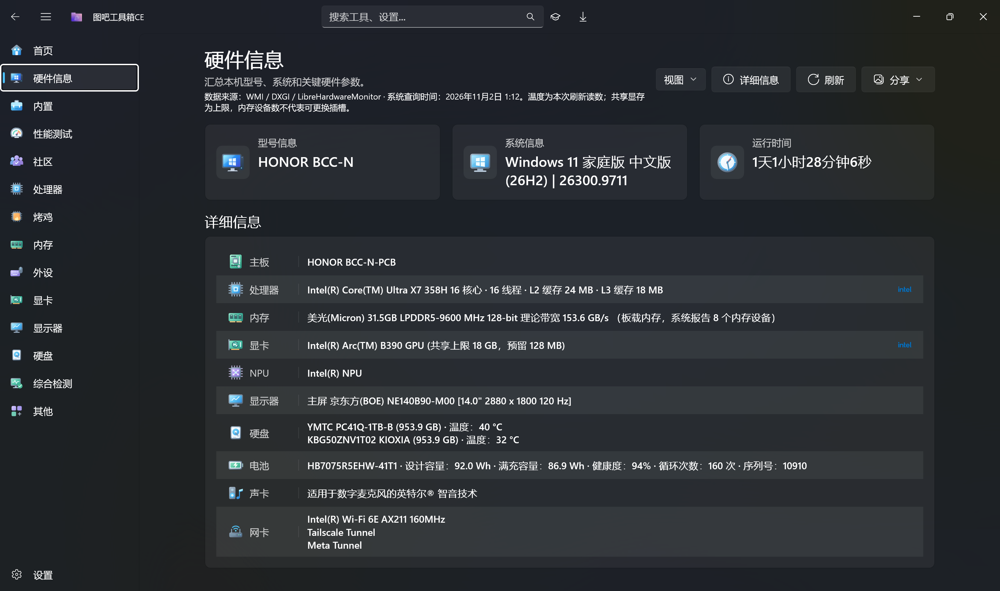
  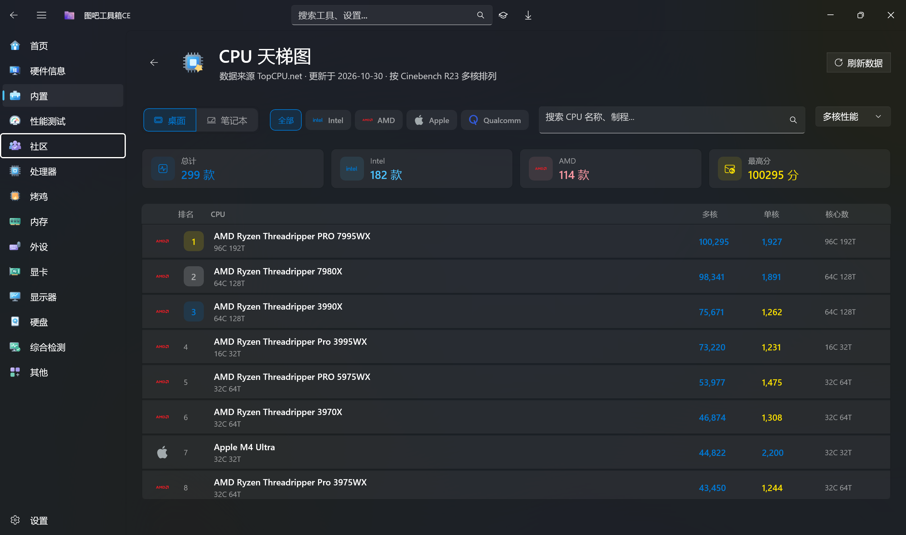

  型号 / 系统 / 处理器 / 内存 / 显卡 / 硬盘 / 网卡一览 + 桌面与笔记本性能天梯图（数据来自 NanoReview）

* **实时监控** —— CPU / GPU / 内存 / 硬盘温度、频率、功耗曲线，前台显示在页面顶栏，也能做成游戏覆盖层
* **磁盘健康** —— SMART 健康度检测（CrystalDiskInfo 方案）：温度 / 通电时间 / 寿命 / 读写量，支持 SSD TRIM 与机械盘碎片整理
* **电池消耗分析** —— 电池消耗趋势与应用耗电排行，比 Windows 设置更强的电池报告
* **键盘测试 / 屏幕坏点检测** —— 按键高亮检测（可区分左右 Shift / Ctrl / Alt）；全屏纯色与检测图案找坏点、漏光
* **核间延迟查询** —— 查看社区上传的核间延迟热力图，对比不同 CPU 的核心间通信延迟

## 游戏工具箱

### 游戏监控（覆盖层设计器）

拖拽式设计监控覆盖层：内置多种布局预设，可自由添加 FPS、CPU / GPU 温度与负载、内存占用等组件；游戏中实时显示，也可勾选指标记录数据（最长 2 小时），结束后一次性导出 JSON / Markdown / CSV 报告。

  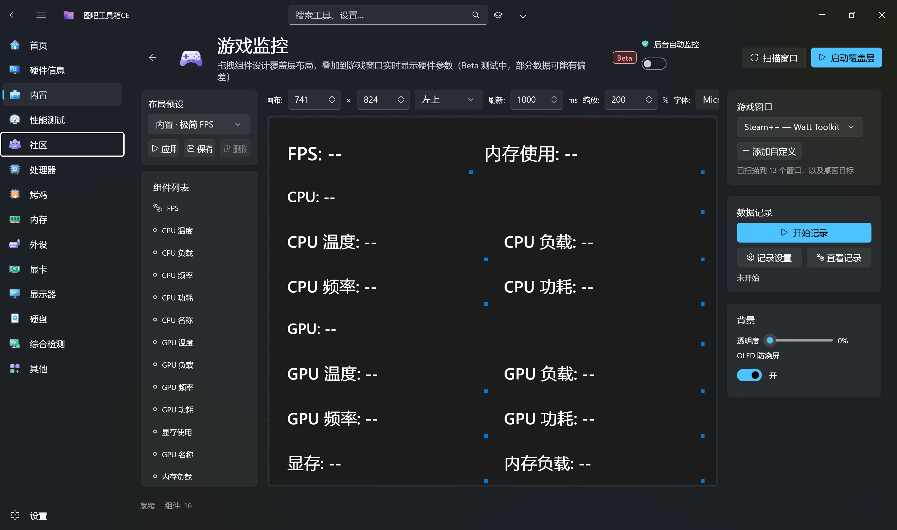
  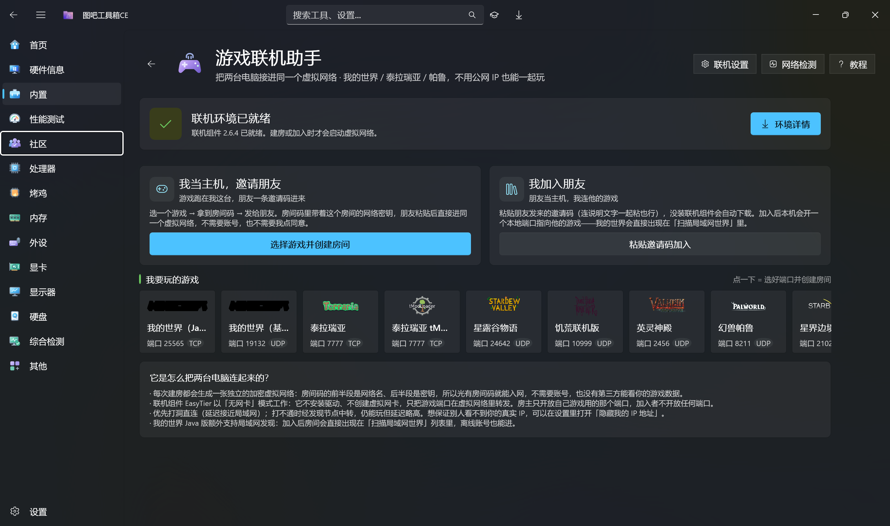

  拖拽设计覆盖层布局、自动识别游戏窗口 ｜ 邀请码一键入网，不用公网 IP、不用改路由器

* **游戏联机助手** —— 基于 EasyTier 的免登录虚拟网络（不装驱动、不建虚拟网卡），我的世界 / 泰拉瑞亚 / 幻兽帕鲁等 TCP / UDP 游戏都能直连；房间码里自带网络密钥，朋友粘贴即入网，我的世界还会直接出现在局域网列表里
* **记录查看** —— 解析导出的记录并图表化回放：每个指标一张独立图表、各自纵轴刻度，支持分组切换、区间裁剪与 P1 / P99 统计
* **运行库修复** —— 一键补齐 Visual C++ 2008-2026、.NET Framework、DirectX 旧版游戏组件（微软官方源 + 签名校验）
* **游戏防晕3D** —— 屏幕中央准星 + 四边标记辅助，缓解 3D 眩晕

## 系统优化与安全

  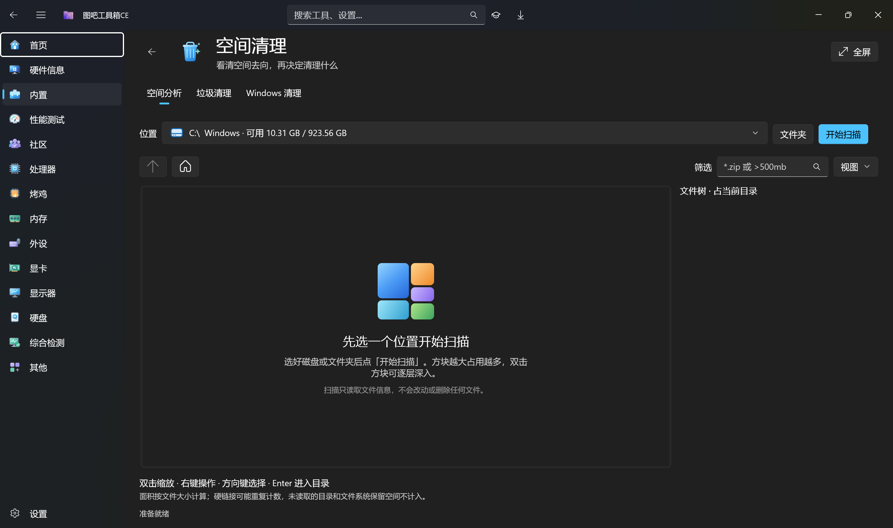
  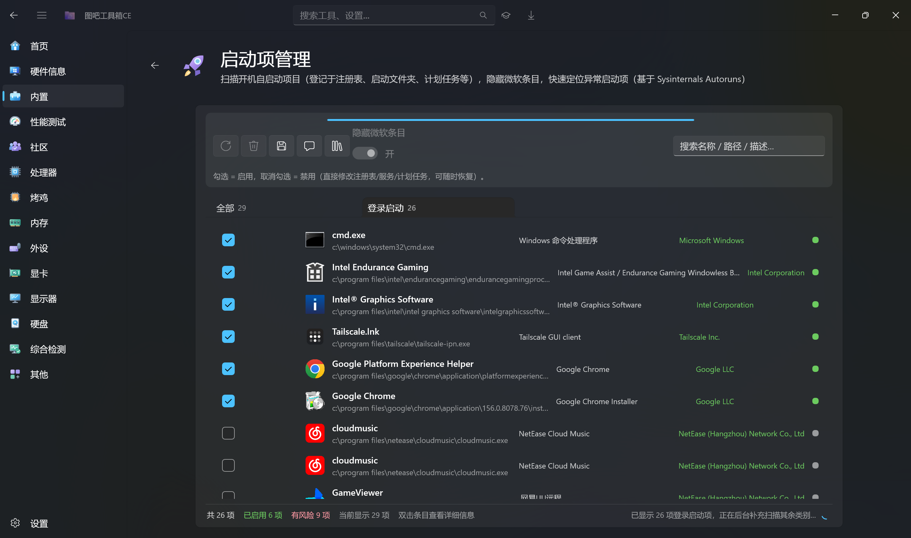
  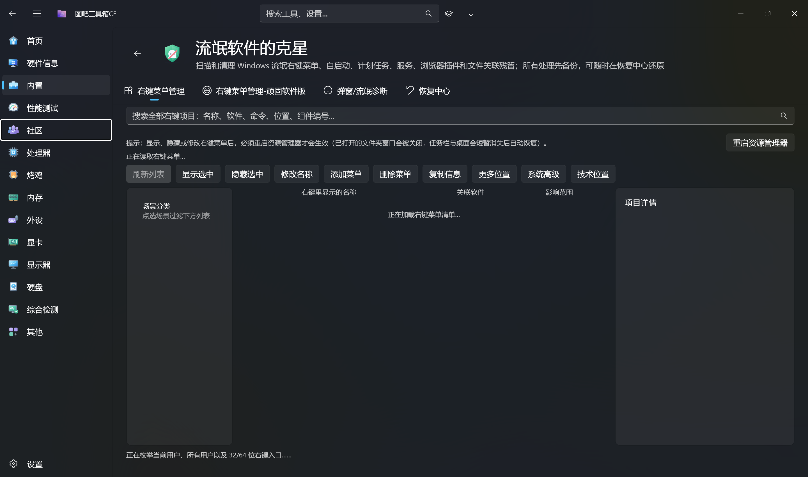

  垃圾清理（Winapp2 规则库 4000+ 条）｜ 启动项管理 ｜ 流氓软件的克星（含恢复中心）

* **恶意软件拦截器** —— 把软件厂商证书加入系统不信任列表，从源头阻止流氓软件安装运行
* **恶意软件沙盒** —— Sandboxie-Plus 沙盒环境，安全运行分析可疑程序，删掉沙盒即可还原
* **右键菜单管理** —— 启用 / 禁用 / 编辑 / 添加 / 删除右键菜单项，覆盖新建 / 发送到 / 打开方式与 WinX 菜单
* **时间同步** —— 一键切换系统 NTP 服务器（阿里云 / 腾讯云 / 国家授时中心…），服务器测速、偏差检测、立即校时与一键修复
* **还有更多** —— 配置修改器 / Windows 隐藏功能 / .NET 环境补全 / 后台节流省电神器 / OptimizerDuck 优化鸭 / Windows 镜像下载

## 网络工具

  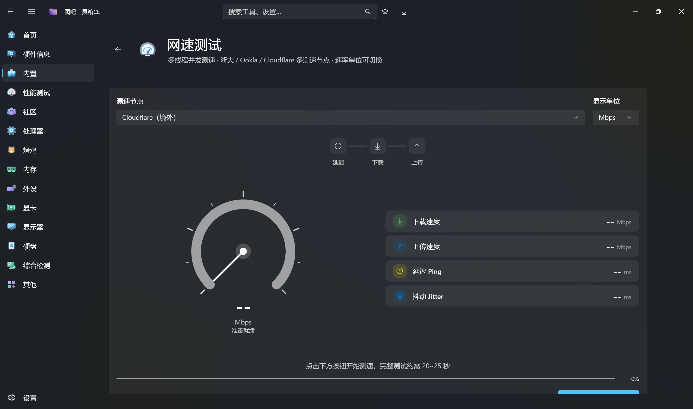
  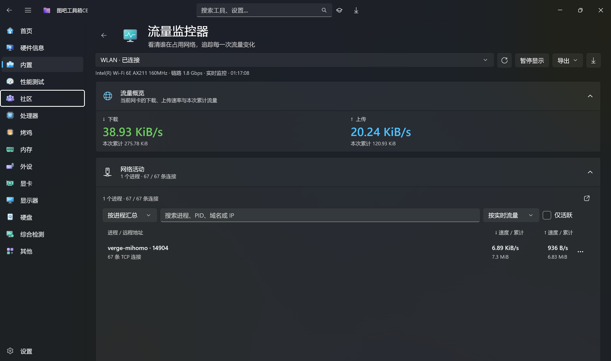
  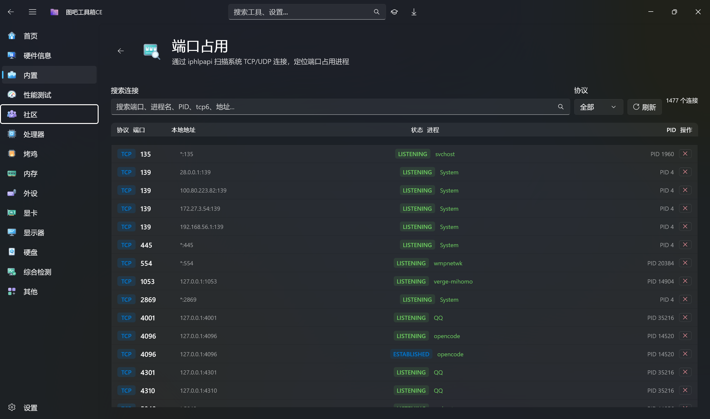

  网速测试（浙大 / Ookla / Cloudflare 多节点）｜ 流量监控器 ｜ 端口占用

* **Hosts 编辑** —— 可视化编辑系统 Hosts，支持启用 / 禁用规则和 DNS 刷新
* **WiFi 密码** —— 查看本机连接过的 WiFi 网络名称和密码
* **网络优化** —— TCP 参数优化、DNS 延迟测速与配置、公网 IP 查询、网络重置与 DHCP 修复
* **网络调度器** —— 汇聚多网络适配器，智能分配流量，Wi-Fi 有线自动加速
* **局域网文件分享** —— 局域网内 HTTP 文件分享服务，其他设备用浏览器直接访问，支持拖拽上传

## 格式转换

拖入文件、选目标格式、批量队列逐个转换：图片 / 音视频 / Word / Excel / PPT / PDF / 文本 / JSON 全部互转，**单个文件失败不打断批次**。

  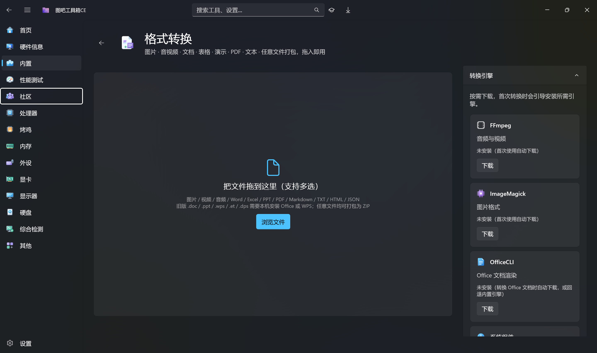

  支持拖入与多选，批量队列处理，可打包 ZIP 交付；每个目标格式自带可调参数（码率 / 位深 / 采样率 / CRF / 分辨率 / 帧率……）

* **文档转换** —— Word / Excel / PPT / PDF / Markdown / HTML / JSON 互转；OOXML 文档内置渲染引擎逐页截图导出 PDF / 长图，中文排版零重采样
* **图片 / 音视频** —— FFmpeg + ImageMagick 双引擎，视频可调编码器、码率控制、预设、分辨率与音轨
* **OCR 识别** —— 调用 Windows 原生 OCR，图片转文字一步到位
* **PDF 工具** —— 合并、拆分、文字层提取表格转 XLSX
* **旧格式兜底** —— .doc / .ppt / .wps 等老格式自动调用本机 Office / WPS 转换，缺失时给出明确提示

## 连接手机（TubaLink）

* **扫码配对** —— 手机扫描电脑页面上的二维码即可连接；TLS + 证书指纹，首次连接电脑端弹窗授权
* **分享菜单直发电脑** —— 在相册、浏览器、文件管理器里分享文字 / 图片 / 文件，直接落到电脑「下载」目录
* **后台接收与下载队列** —— 手机退到后台也能收到电脑推送的文件通知，支持进度、取消、重试；默认不常驻通知
* **摄像头直播** —— 电脑端开启「允许手机查看摄像头」后，手机可实时查看摄像头画面并截图保存
* **副屏模式** —— 手机端网格化自定义仪表盘：文字、时钟、图片、监控数值、曲线、环形表、状态、分隔线；编辑后可全屏展示
* **实时监控 / 远程命令 / winget / 聊天互传** —— 查看电脑硬件与实时数据、执行 PowerShell、搜索安装软件、互发消息与文件

## 实用工具

  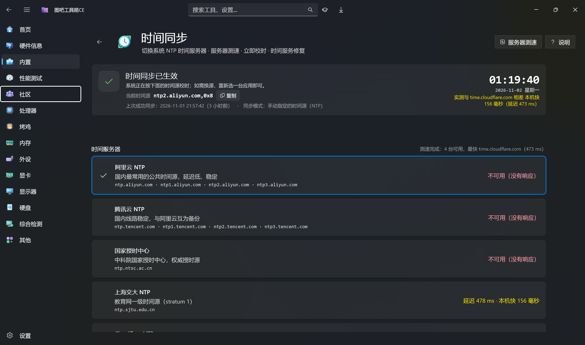
  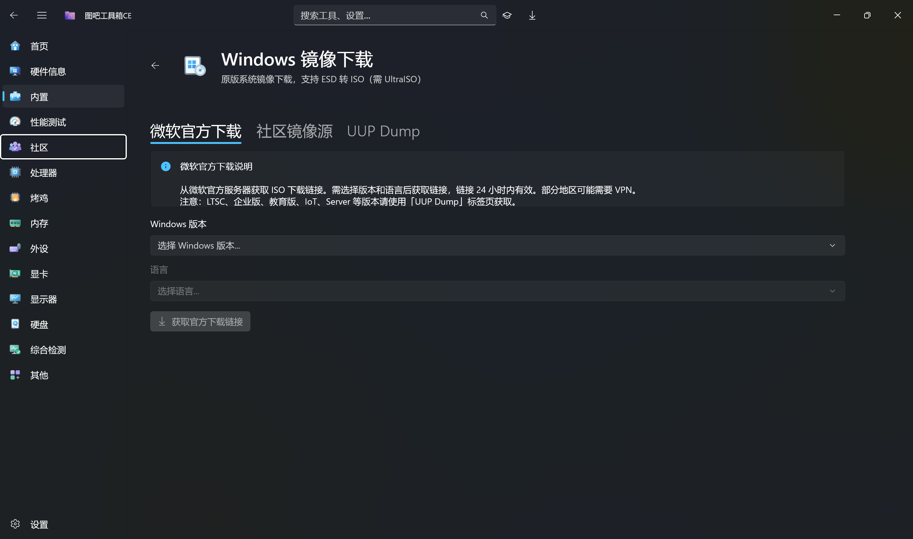
  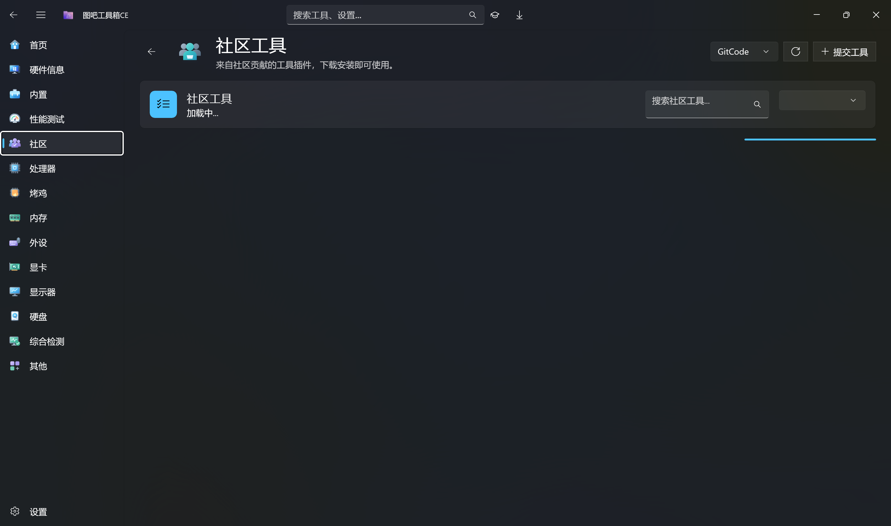

  时间同步（NTP 服务器测速与一键校时）｜ Windows 镜像下载（UUP Dump 官方 API）｜ 社区工具

* **电脑使用教程** —— 新电脑开箱指南、基础操作、烤机检测、常识与辟谣
* **常用官网 / 服务网点查询** —— Steam、Epic、UU 加速器等官网一键直达；各大品牌官方服务网点地址
* **正版软件商店 / UniGetUI** —— 基于 WinGet 及 winget / scoop / chocolatey / pip / npm 的软件安装与管理
* **电子文盲测试** —— 25 道电脑基础知识选择题，测测你的水平
* **社区工具** —— 社区贡献的工具插件，下载安装即用（仅免安装版提供）
